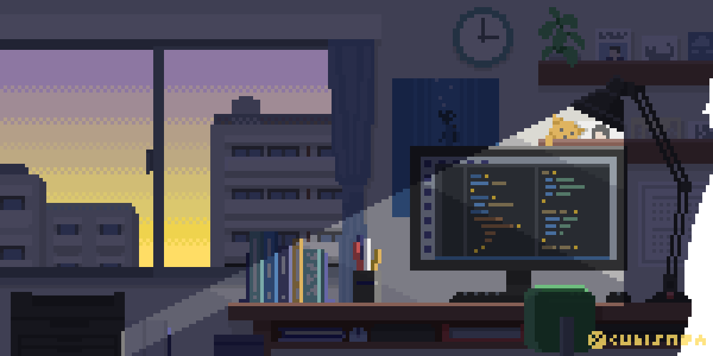
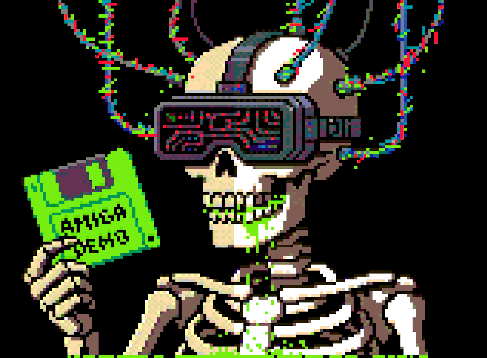

<!-- ============ BANNER ============ -->

  

<h1 align="center">Hi, my name is Eduardo 👋</h1>

  Software Engineering Student • Aspiring Developer

<!-- ============ IMAGEM ============ -->

  

---

## 👨‍💻 About me

- 🎓 **Currently pursuing a degree in Software Engineering**
- 🔭 Currently studying and building **back-end and web development projects**
- 🌱 Learning: Java, web development, databases, and more
- 💬 Ask me about: My latest projects
- 📫 Contact: [www.linkedin.com/in/dudu-i-martins](https://www.linkedin.com/in/dudu-i-martins)

---

## 🛠️ Technologies

  
  
  
  
  
  
  
  
  
  

---

## 📊 GitHub Stats

  
  

---

## 🐍 Contribution Graph

<!-- Só aparece depois que o workflow "generate animation" rodar e criar a branch "output" -->
<picture>
  <source media="(prefers-color-scheme: dark)" srcset="https://raw.githubusercontent.com/Eduardo062au/Eduardo062au/output/github-contribution-grid-snake-dark.svg">
  
</picture>

---

## 📫 Contact

  

